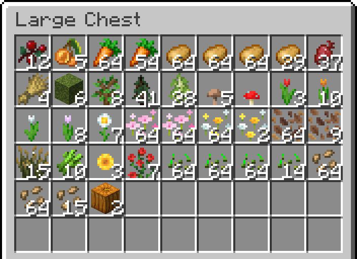
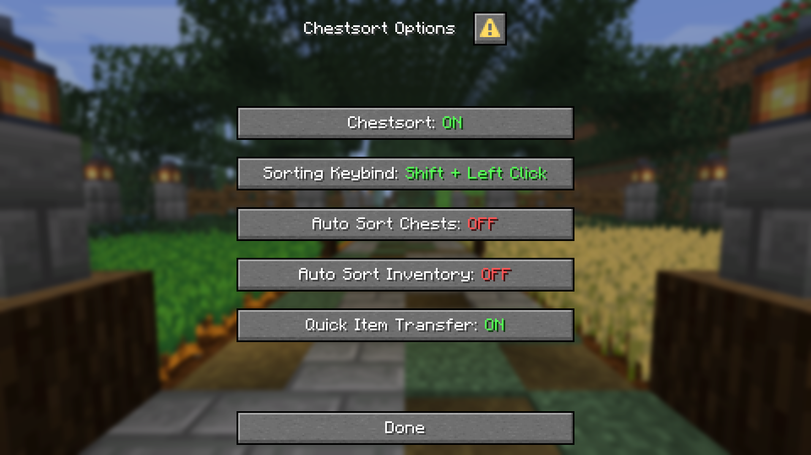

# Chestsort+

Chestsort+ is a modern, lightweight PaperMC plugin that lets players sort their inventory, chests and other containers.
Players can sort manually with a configurable keybind and enable automatic sorting on a per-player basis.
With the quick transfer feature, players can move matching items or all possible items between their inventory and open
containers.
Players can configure all features through a modern dialog interface.

- The player's inventory and hotbar can be sorted separately
- Items are sorted based on the creative inventory order
- The order of the categories can be configured in `config.yml`
- Matching items are stacked together when sorting
- Donkey and llama inventories are supported

| Chest Sorting                            | Chestsort Options                       |
|------------------------------------------|-----------------------------------------|
|  |  |

## Permission

`chestsort.use` is required for players to use the sorting feature.

## Commands

| Command              | Description                                        | Permission        |
|----------------------|----------------------------------------------------|-------------------|
| `/chestsort`         | Opens the Chestsort Options dialog                 | `chestsort.use`   |
| `/chestsort reload`  | Reloads the plugin's configuration files           | `chestsort.admin` |
| `/chestsort version` | Displays the plugin version and checks for updates | `chestsort.admin` |

## Keybind Actions

| Action                          | Keybinds                                                                       | Description                                                                               |
|---------------------------------|--------------------------------------------------------------------------------|-------------------------------------------------------------------------------------------|
| Sort inventory                  | `Shift + Left Click`, `Shift + Right Click` or `Double Click` on an empty slot | Sorts the clicked inventory section or container, depending on configured sorting keybind |
| Quick transfer to container     | `Left Click` outside the inventory                                             | Moves matching items from the player inventory into the open container                    |
| Quick transfer to player        | `Right Click` outside the inventory                                            | Moves matching items from the open container into the player inventory                    |
| Transfer all items to container | `Double Left Click` outside the inventory                                      | Moves all possible items from the player's inventory into the open container              |
| Transfer all items to player    | `Double Right Click` outside the inventory                                     | Moves all possible items from the open container into the player's inventory              |
